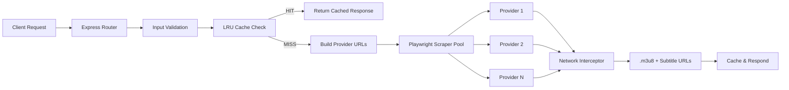
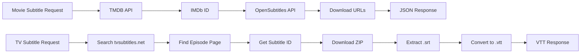

<div align="center">

# ⚡ ARYX M3U8 SCRAPER

### Production-Grade HLS Stream Extractor & Subtitle Scraper API

[](LICENSE)
[](https://nodejs.org/)
[](Dockerfile)
[](https://expressjs.com/)
[](https://playwright.dev/)
[](CONTRIBUTING.md)

*Extract HLS `.m3u8` stream URLs and subtitles from multiple providers via a single REST API.*

</div>

---

## 📑 Table of Contents

- [Features](#-features)
- [Architecture](#-architecture)
- [Quick Start](#-quick-start)
- [Docker](#-docker)
- [API Reference](#-api-reference)
- [Environment Variables](#-environment-variables)
- [Supported Providers](#-supported-providers)
- [Project Structure](#-project-structure)
- [Contributing](#-contributing)
- [License](#-license)
- [Disclaimer](#-disclaimer)

---

## ✨ Features

- 🎬 **Multi-Provider Scraping** — Scrapes 5+ streaming providers simultaneously
- 📡 **HLS Extraction** — Captures `.m3u8` master playlist URLs via network interception
- 📝 **Movie Subtitles** — OpenSubtitles integration with multi-language support (10 languages)
- 📺 **TV Subtitles** — tvsubtitles.net scraping pipeline with auto release-group correction
- 🔄 **SRT → VTT Conversion** — Inline subtitle proxy with format conversion
- 🧠 **TMDB Integration** — Automatic TMDB → IMDb ID resolution for subtitle lookups
- ⚡ **LRU Cache** — Configurable in-memory cache with TTL and hit-rate tracking
- 🌐 **Browser Automation** — Headless Chromium via Playwright with auto-restart on crash
- 🐳 **Docker Ready** — Multi-stage build, non-root user, health checks, signal handling
- 🔒 **SSRF Protection** — Domain allowlist on subtitle proxy to prevent server-side request forgery
- 🛡️ **Input Validation** — Strict query parameter validation on all endpoints
- 🔁 **Retry Logic** — Exponential backoff with jitter on all external API calls
- 🎭 **User-Agent Rotation** — Pool of 8 realistic browser fingerprints per scrape
- 📊 **Health & Metrics** — `/health` endpoint with uptime, memory, cache stats, and request metrics
- 🪵 **Structured Logging** — Timestamped, leveled logging with request ID correlation
- 🔌 **Graceful Shutdown** — Proper connection draining, browser cleanup, and timeout-based force exit
- 🏷️ **API Versioning** — All routes prefixed under `/api/v1/` with legacy redirects
- ↩️ **Backwards Compatible** — Legacy routes (e.g., `/extract`) redirect to `/api/v1/extract`

---

## 🏗 Architecture

### Stream Extraction Flow



### Subtitle Resolution Flow



---

## 🚀 Quick Start

### Prerequisites

- **Node.js** v18 or higher
- **npm** or **yarn**
- API keys for [TMDB](https://www.themoviedb.org/settings/api) and [OpenSubtitles](https://www.opensubtitles.com/consumers)

### Installation

```bash
# Clone the repository
git clone https://github.com/ARYX/aryx-m3u8-scraper.git
cd aryx-m3u8-scraper

# Install dependencies
npm install

# Install Playwright browsers
npx playwright install chromium

# Configure environment
cp .env.example .env
# Edit .env with your API keys

# Start the server
npm start
```

The server will start at `http://localhost:4000`.

---

## 🐳 Docker

### Build & Run

```bash
# Build the image
docker build -t aryx-m3u8-scraper .

# Run the container
docker run -d \
  --name aryx-scraper \
  -p 4000:4000 \
  -e TMDB_API_KEY=your_key \
  -e TMDB_BEARER_TOKEN=your_token \
  -e OPENSUB_API_KEY=your_key \
  aryx-m3u8-scraper
```

### Docker Compose

```yaml
version: "3.8"
services:
  aryx-scraper:
    build: .
    container_name: aryx-m3u8-scraper
    ports:
      - "4000:4000"
    environment:
      - PORT=4000
      - NODE_ENV=production
      - TMDB_API_KEY=${TMDB_API_KEY}
      - TMDB_BEARER_TOKEN=${TMDB_BEARER_TOKEN}
      - OPENSUB_API_KEY=${OPENSUB_API_KEY}
      - CACHE_MAX_SIZE=200
      - CACHE_TTL_MINUTES=15
    restart: unless-stopped
    healthcheck:
      test: ["CMD", "node", "-e", "fetch('http://localhost:4000/api/v1/health').then(r=>{if(!r.ok)throw 1;process.exit(0)}).catch(()=>process.exit(1))"]
      interval: 30s
      timeout: 10s
      retries: 3
```

---

## 📖 API Reference

### Root — `GET /`

Returns server info and available endpoints.

```bash
curl http://localhost:4000/
```

---

### Extract — `GET /api/v1/extract`

Scrapes HLS stream URLs and subtitle files from multiple providers.

| Parameter | Type    | Required        | Description                    |
|-----------|---------|-----------------|--------------------------------|
| `tmdb_id` | string  | ✅ Yes          | TMDB movie or TV show ID       |
| `type`    | string  | No (default: `movie`) | `"movie"` or `"tv"`      |
| `season`  | integer | Required if `tv` | Season number                  |
| `episode` | integer | Required if `tv` | Episode number                 |

**Movie Example:**
```bash
curl "http://localhost:4000/api/v1/extract?tmdb_id=550&type=movie"
```

**TV Example:**
```bash
curl "http://localhost:4000/api/v1/extract?tmdb_id=1399&type=tv&season=1&episode=1"
```

**Response:**
```json
{
  "success": true,
  "results": {
    "YapGrid": {
      "hls_url": "https://example.com/stream/master.m3u8",
      "subtitles": ["https://example.com/subs/en.vtt"],
      "error": null
    },
    "CineSrc": {
      "hls_url": "https://example.com/stream2/master.m3u8",
      "subtitles": [],
      "error": null
    }
  },
  "meta": {
    "tmdb_id": "550",
    "type": "movie",
    "providers_queried": 5,
    "cached": false
  },
  "timestamp": "2026-10-25T00:00:00.000Z"
}
```

---

### Movie Subtitles — `GET /api/v1/movie-subtitles`

Fetches subtitles for movies via TMDB → OpenSubtitles pipeline.

| Parameter | Type   | Required | Description       |
|-----------|--------|----------|-------------------|
| `tmdb_id` | string | ✅ Yes   | TMDB movie ID     |
| `type`    | string | No       | Default: `"movie"` |

```bash
curl "http://localhost:4000/api/v1/movie-subtitles?tmdb_id=550"
```

---

### TV Subtitles — `GET /api/v1/tv-subtitles`

Fetches and converts TV show subtitles (returns `.vtt` content).

| Parameter | Type    | Required | Description      |
|-----------|---------|----------|------------------|
| `title`   | string  | ✅ Yes   | TV show title    |
| `season`  | integer | ✅ Yes   | Season number    |
| `episode` | integer | ✅ Yes   | Episode number   |
| `type`    | string  | ✅ Yes   | Must be `"tv"`   |

```bash
curl "http://localhost:4000/api/v1/tv-subtitles?title=Breaking+Bad&season=1&episode=1&type=tv"
```

---

### Subtitle Proxy — `GET /api/v1/subtitle-proxy`

Proxies and converts an external `.srt` subtitle to `.vtt` format. Includes SSRF protection.

| Parameter | Type   | Required | Description              |
|-----------|--------|----------|--------------------------|
| `url`     | string | ✅ Yes   | URL of the subtitle file |

```bash
curl "http://localhost:4000/api/v1/subtitle-proxy?url=https://dl.opensubtitles.org/sub/12345"
```

---

### Health Check — `GET /api/v1/health`

Returns server health, browser status, memory, cache stats, uptime, and metrics.

```bash
curl http://localhost:4000/api/v1/health
```

**Response:**
```json
{
  "success": true,
  "data": {
    "status": "healthy",
    "version": "2.0.0",
    "uptime": "2h 15m 30s",
    "browser": "connected",
    "memory": { "rss": "185MB", "heapUsed": "52MB", "heapTotal": "75MB" },
    "cache": { "size": 12, "maxSize": 200, "hits": 45, "misses": 8, "hitRate": "84.9%" },
    "metrics": { "totalRequests": 120, "successfulExtractions": 95, "failedExtractions": 5 },
    "providers": ["YapGrid", "CineSrc", "VidSrc XYZ", "EmbedSU", "VidSrc PM"],
    "nodeVersion": "v22.0.0"
  },
  "timestamp": "2026-10-25T00:00:00.000Z"
}
```

---

## 🔧 Environment Variables

| Variable               | Required | Default | Description                              |
|------------------------|----------|---------|------------------------------------------|
| `PORT`                 | No       | `4000`  | Server port                              |
| `NODE_ENV`             | No       | —       | `development` or `production`            |
| `TMDB_API_KEY`         | Yes      | —       | TMDB API key                             |
| `TMDB_BEARER_TOKEN`    | Yes      | —       | TMDB Bearer token                        |
| `OPENSUB_API_KEY`      | Yes      | —       | OpenSubtitles API key                    |
| `CORS_ORIGINS`         | No       | `*`     | Comma-separated allowed origins          |
| `CACHE_MAX_SIZE`       | No       | `200`   | Max cached responses                     |
| `CACHE_TTL_MINUTES`    | No       | `15`    | Cache entry lifetime (minutes)           |
| `MAX_CONCURRENT_SCRAPES` | No     | `3`     | Parallel provider scrape limit           |
| `NAVIGATION_TIMEOUT`   | No       | `30000` | Browser navigation timeout (ms)          |

---

## 🌐 Supported Providers

| Provider    | Domain             | Movie | TV  |
|-------------|--------------------|-------|-----|
| YapGrid     | `yapgrid.com`      | ✅    | ✅  |
| CineSrc     | `cinesrc.st`       | ✅    | ✅  |
| VidSrc XYZ  | `vidsrc.xyz`       | ✅    | ✅  |
| EmbedSU     | `embed.su`         | ✅    | ✅  |
| VidSrc PM   | `vidsrc.pm`        | ✅    | ✅  |

---

## 📁 Project Structure

```
aryx-m3u8-scraper/
├── server.js            # Main Express server — routes, scraper, cache, lifecycle
├── utils/
│   └── tvSubtitles.js   # TV subtitle pipeline — search, download, convert
├── test.js              # Test suite (node:test)
├── package.json         # Dependencies & scripts
├── Dockerfile           # Multi-stage production Docker image
├── .dockerignore        # Docker build exclusions
├── .env.example         # Environment variable template
├── .gitignore           # Git exclusions
└── readme.md            # This file
```

---

## 🤝 Contributing

Contributions are welcome!

1. **Fork** the repository
2. **Create** a feature branch (`git checkout -b feature/amazing-feature`)
3. **Commit** your changes (`git commit -m "Add amazing feature"`)
4. **Push** to the branch (`git push origin feature/amazing-feature`)
5. **Open** a Pull Request

---

## 📄 License

This project is licensed under the **MIT License**. See [LICENSE](LICENSE) for details.

---

## ⚠️ Disclaimer

> **This project is for educational and research purposes only.**
> The authors do not endorse or encourage piracy or unauthorized access to copyrighted content.
> Users are solely responsible for ensuring their use of this software complies with all applicable laws and terms of service.
> Use at your own risk.

---

<div align="center">

**Built with ❤️ by ARYX**

</div>
